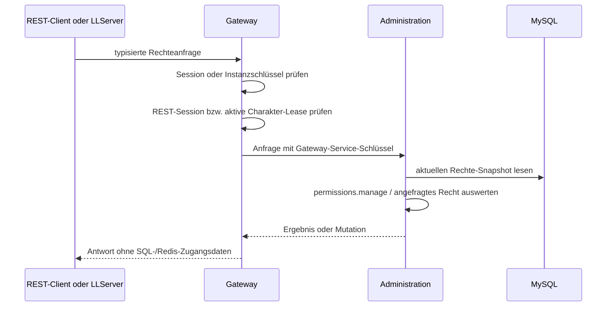

# Lancer Nexus Berechtigungs- und Gruppensystem

**Stand:** 2026-09-27
**Geltungsbereich:** Gateway, Administration, Cluster, Protocol und LibreLancer-Client/Server-Patches

Diese Dokumentation beschreibt das zentrale Berechtigungsmodell, die SQL-Daten, die API-Grenzen, die Ingame-Befehle, den lokalen Notfall-OP und den tatsächlichen Integrationsstand. Sie ist zugleich Betriebs- und Entwicklerreferenz.

## 1. Ziel und Zuständigkeiten

Das System stellt eine zentrale, SQL-basierte Rechtequelle für Nexus-Konten bereit. Es orientiert sich an den Funktionen von PermissionsEx: einzelne Permission-Knoten, geordnete Gruppen, Vererbung, Rangstufen, Prefixe/Suffixe, Geltungsbereiche und zeitlich begrenzte Zuweisungen.

MySQL ist autoritativ. Redis transportiert ausschließlich Revisionshinweise. Clients erhalten weder MySQL- noch Redis-Zugangsdaten. Gateway identifiziert den Konto-, Session- und Charakterkontext. Administration prüft Rechte und schreibt Änderungen. Cluster stellt die gemeinsame C#-Auswertung und die Snapshot-Synchronisierung für Spielserver bereit.

| Komponente | Verantwortung |
| --- | --- |
| Protocol | Versionierte Revisionsmeldung und ACK-Vertrag |
| Administration | SQL-Modell, Migration, Rechteprüfung, Mutation, Audit, Idempotenz und Redis-Outbox |
| Gateway | Öffentliche REST- und interne Game-Routen; Session, Instanzschlüssel und Charakter-Lease prüfen |
| Cluster | Gemeinsame `IPermissionService`-API, unveränderter Snapshot, Snapshot-/ACK-Koordination und Redis-Listener |
| LibreLancer Client/LLServer | Patchbasierte Ingame-Befehle und lokaler Einzelserver-Notfall-OP |

## 2. Architektur und Datenfluss

### Rechteprüfung



### Rechteänderung und vorgesehene Instanzsynchronisierung

```mermaid
sequenceDiagram
    participant Caller as REST-Client oder Ingame-Befehl
    participant GW as Gateway
    participant Admin as Administration
    participant SQL as MySQL + Outbox
    participant Redis
    participant Instance as Cluster-Instanz
    Caller->>GW: Mutation + Korrelations- und Idempotenz-ID
    GW->>GW: Identität, Session und ggf. Charakter-Lease prüfen
    GW->>Admin: typisierte Mutation, Actor durch Gateway attestiert
    Admin->>SQL: Revision sperren, Actor autorisieren, Mutation + Audit + Outbox committen
    Admin->>Redis: Revisionshinweis aus Outbox veröffentlichen
    Redis-->>Instance: EventId und neue Revision
    Instance->>GW: vollständigen Snapshot mit Instanzschlüssel laden
    GW->>Admin: Snapshot über internen Service-Schlüssel
    Admin->>SQL: aktuellen Snapshot lesen
    Admin-->>GW: Snapshot
    GW-->>Instance: Snapshot
    Instance->>Instance: Snapshot validieren und atomar aktivieren
    Instance->>GW: ACK mit Revision
    GW->>Admin: ACK; Instanz-ID aus authentifiziertem Schlüssel
    Admin->>SQL: ACK speichern
    Admin-->>Caller: 200 nach ACKs oder 202 sync_pending
```

Der Ablauf ist das Zielverhalten der bereitgestellten Komponenten. Der Listener und Koordinator im Cluster-Projekt sind implementiert, werden aber derzeit noch nicht beim LLServer-Start instanziiert. Darum gibt es aus laufenden LLServer-Prozessen noch keine ACKs; Mutationen bleiben momentan `202 sync_pending`. Details dazu stehen in [Abschnitt 12](#12-bekannte-integrationsgrenzen).

## 3. Datenmodell

Migration [002_permissions.sql](../sql/002_permissions.sql) wird nach dem Gateway-Konto-/Lease-Schema und Administration-Migration `001_admin_queries.sql` auf derselben Datenbank ausgeführt. Danach seedet [003_command_operator_group.sql](../sql/003_command_operator_group.sql) einmalig die Gruppe `operator` mit den unten aufgeführten einzelnen Spielbefehl-Rechten. Die Gruppe wird keinem Konto automatisch zugewiesen.

| Tabelle | Zweck |
| --- | --- |
| `permission_state` | Einziger monoton steigender Rechte-Revisionszähler |
| `permission_groups` | Gruppenname, Rang, Rangstufenleiter, Prefix und Suffix |
| `permission_group_inheritance` | Geordnete Gruppenvererbung; Zyklen sind unzulässig |
| `permission_group_nodes` | Geordnete Allow-/Deny-Knoten je Gruppe |
| `permission_user_groups` | Geordnete, optionale zeit- und bereichsbegrenzte Konto-Mitgliedschaften |
| `permission_user_nodes` | Geordnete, optionale zeit- und bereichsbegrenzte Konto-Rechte |
| `permission_outbox` | Dauerhafte, wiederholbare Revisionshinweise für Redis |
| `permission_instance_ack` | Höchste aktivierte Revision und ACK-Zeitpunkt je Instanz |
| `permission_audit` | Append-orientierte Aufzeichnung von Actor, Quelle, Ziel, Mutation und Revision |
| `permission_mutation_keys` | Actor-begrenzte Idempotenz mit Payload-Fingerprint und Ergebnis |

Konto-IDs referenzieren die bestehende Gateway-Tabelle `accounts`. Das alte Tabellenmodell (`admins`, `admin_role_assignments`, `admin_role_permissions`) bleibt beim Übergang bestehen. Migration 002 importiert aktivierte Admin-Zuweisungen als Gruppenmitgliedschaften und bestehende Rollenrechte als Gruppen-Knoten. Die Anwendung verwendet danach das neue Rechte-Modell.

Migration 002 seedet eine leere Gruppe `default`; sie erteilt keine Rechte. Sie erzeugt außerdem die Gruppe `cluster-observer` und importiert vorhandene Rollen gleichen Namens. Migration 003 erstellt die Gruppe `operator` samt neun einzelnen `command.*`-Allows und erhöht die Revision samt Outbox-Hinweis genau einmal. Kein Konto wird dadurch OP. Konten, die schon vor Migration 002 existierten, erhalten `default`, sofern diese globale Mitgliedschaft noch nicht besteht. Keine Migration legt ein privilegiertes Konto an.

Jeder künftige Konto-Provisionierungspfad muss die globale `default`-Mitgliedschaft in derselben Provisionierung ergänzen. Migration 002 läuft nicht automatisch bei jedem neu angelegten Konto.

### Verifizierter E2E-Testdatenbankstand

Migration und Wiederholung wurden am 2026-09-27 in der isolierten Datenbank `lancer_nexus_e2e` mit MariaDB 10.6.23 geprüft. Vor dem Lauf enthielt sie einen Account, einen Admin, eine Rollen-Zuweisung und drei Rollenrechte. Danach bestanden zwei Gruppen, drei importierte Observer-Rechte und zwei Mitgliedschaften. Revision 1 wurde beibehalten. Ein zweiter Lauf der 17 SQL-Anweisungen änderte weder Zähler noch Revision. Siehe [Testdatenbank-Protokoll](permissions-testdb.md). Das ist ein Schema-/Importtest, kein Laufzeittest des Redis-/LLServer-Syncs.

## 4. Rechtesemantik

Die öffentliche Auswertung liegt in `LancerNexus.Cluster` unter `IPermissionService`. Die Snapshot-Konstruktion validiert den kompletten Gruppen-Graphen vor Veröffentlichung.

### Reihenfolge

Bei `HasPermission(accountId, permission, context)` entscheidet der **erste passende Knoten**:

1. Direkte Benutzer-Knoten, sortiert nach Bereichsspezifität und danach gespeicherter Position.
2. Gruppen in der Reihenfolge der passenden Konto-Mitgliedschaften; spezifischere Mitgliedschaften stehen zuerst.
3. Je Gruppe zuerst die eigene Regelmenge, danach ihre Eltern in gespeicherter Vererbungsreihenfolge (Tiefensuche).
4. Gibt es keinen Treffer, ist das Ergebnis `false`.

Damit haben direkte Konto-Knoten Vorrang vor jedem Gruppen-Knoten. Bei gleichem Rechte-Muster gewinnt ein früheres Allow oder Deny. Ein Deny ist nicht automatisch global vorrangig: Ein früherer passender Allow kann ein späteres Deny überdecken. Reihenfolge und Scope sind daher Teil der Sicherheitskonfiguration.

Die Gruppenauswertung besucht eine Gruppe innerhalb eines Kontos nur beim ersten Auftreten. Das verhindert Mehrfachauswertung desselben geerbten Knotens bei mehreren Vererbungswegen. Vererbungszyklen und doppelte Eltern werden bei Snapshot-Erstellung abgelehnt.

### Bereiche und Spezifität

Ein Knoten oder eine Mitgliedschaft kann global oder auf System und/oder Instanz beschränkt sein. Alle angegebenen Bereiche müssen zum Prüfkontext passen.

Die momentane Sortiergewichtung ist:

| Passender Bereich | Gewicht |
| --- | ---: |
| global | 0 |
| aktuelles System | 1 |
| aktuelle Instanz | 2 |
| aktuelles System und aktuelle Instanz | 3 |

Bei gleichem Gewicht entscheidet die gespeicherte Position. System- und Instanz-IDs werden ohne Beachtung der Groß-/Kleinschreibung verglichen. Fehlt der Prüfkontext, passen keine system- oder instanzbegrenzten Einträge.

### Ablaufzeiten

Benutzer-Knoten, Gruppen-Knoten und Gruppenmitgliedschaften unterstützen `ExpiresUtc`/`expires_utc`. Ein Eintrag gilt nur, solange das Ablaufdatum strikt später als die Prüfzeit ist. Abgelaufene Mitgliedschaften werden bei der Gruppenauswertung ignoriert; abgelaufene Knoten werden übersprungen. Das Löschen abgelaufener Zeilen ist für die Semantik nicht nötig.

### Musterarten

Alle Rechtevergleiche sind ohne Beachtung der Groß-/Kleinschreibung.

| Art | Verhalten |
| --- | --- |
| Exact | Vollständiger Gleichheitsvergleich, z. B. `cluster.status` |
| Wildcard | Punktsegment-Muster: `*` als nichtletztes Segment entspricht genau einem Segment; terminales `*` entspricht einem oder mehreren verbleibenden Segmenten; `**` entspricht null oder mehr Segmenten |
| Regex | .NET-Regex mit `NonBacktracking`, 25-ms-Timeout und begrenzter Regex-Cache-Größe |

### Permissions für bestehende LibreLancer-Adminbefehle

Die neun bisherigen Admin-Spielbefehle prüfen ihre eigene Permission über Gateway und das SQL-Rechtesystem. `IConsoleCommand.Permission` benennt jeden Knoten einzeln; `ConsoleCommands.Run` führt geschützte Befehle erst nach der erfolgreichen Prüfung durch `GameServer.HasCommandPermissionAsync` aus. Die Anfrage bindet Konto, aktive Sitzung, Charakter-Lease, Instanz und aktuelles System. Bei Fehlern oder Nichterreichbarkeit wird der Befehl verweigert. LibreLancer verwendet dafür kein `Character.Admin`-Laufzeitflag mehr. Das alte SQLite-Feld bleibt ausschließlich für Schema-/Bestandskompatibilität erhalten und wird nicht als Berechtigungsquelle ausgewertet.

| Permission-Knoten | Chatbefehl | Geschützte Aktion | Risikohinweis |
| --- | --- | --- | --- |
| `command.addcash` | `/addcash [spieler] <credits>` | Credits beim eigenen oder angegebenen Online-Charakter ändern | Ökonomischer Eingriff; Zielkonto und Betrag auditieren |
| `command.base` | `/base <basisname>` | Spieler zur benannten Basis versetzen/landen lassen | Positions-/Zustandsänderung |
| `command.damageself` | `/damageself <wert>` | Eigenen Schiffsrumpf beschädigen | Kann den Charakter gefährden |
| `command.godmode` | `/godmode` | Unverwundbarkeit des eigenen Schiffs umschalten | Kampf-/Spielzustand beeinflussen |
| `command.npc` | `/npc <skript>` | NPC-Skript auf der Instanz ausführen | Spielweltwirkung des freigegebenen NPC-Skripts |
| `command.setlevel` | `/setlevel [spieler] <level>` | Rang des eigenen oder eines Online-Charakters setzen | Progression ändern; Ziel und Rang auditieren |
| `command.spawnloot` | `/spawnloot <ausrüstung> <anzahl>` | Loot im Weltraum erzeugen | Inventar-/Wirtschaftswirkung |
| `command.stop` | `/stop` | Eigenes Schiff anhalten | Begrenzte unmittelbare Spielwirkung |
| `command.warp` | `/warp <x> <y> <z>` | Eigenes Schiff an Koordinaten versetzen | Positions-/Sicherheitsgrenzen prüfen |

Die neun `command.*`-Knoten sind absichtlich einzeln und nicht als breite `command.*`-Grant-Vorlage zusammengefasst. Migration 003 legt sie als einzelne Grants für die Gruppe `operator` an, weist diese Gruppe aber keinem Konto automatisch zu. `/admin op <UUID> [global|instance]` und `/admin deop <UUID> [global|instance]` weisen die Gruppe zu beziehungsweise entfernen sie; dafür benötigt das ausführende Konto `permissions.manage`. Die Host-Konsole behält den getrennten lokalen Notfall-OP für Standalone-LLServer ohne Gateway. Die öffentlichen Diagnosebefehle `/help`, `/pos`, `/ping` und `/debug` benötigen keine Admin-Permission.

Der aktuelle Revisions-/Snapshot-ACK-Listener im LLServer bleibt ein eigener offener Synchronisationspunkt; er ist nicht Voraussetzung für die synchrone Freigabeprüfung pro Befehl. Eine fehlende oder veraltete zentrale Antwort berechtigt nie zur Ausführung.

Regex-Muster dürfen maximal 256 Zeichen lang sein. Backslashes und Konstrukte mit `(?` (unter anderem Lookarounds und Gruppenoptionen) werden abgelehnt. Ungültige/unsichere Muster verhindern die Aktivierung des gesamten Kandidat-Snapshots.

Beispiel für einen Plugin-Aufruf:

```csharp
var context = new PermissionContext(instanceId, systemId);
if (!permissionService.HasPermission(accountId, "player.kick", context))
    return Denied();

var prefix = permissionService.GetPrefix(accountId, context);
var groups = permissionService.GetGroupNames(accountId, context);
```

Die aufrufende Stelle muss zusätzlich sicherstellen, dass der umgebende Server-Sync bereit ist. Der Interface-Aufruf ersetzt weder Session-/Lease-Validierung noch Audit für administrative Aktionen.

### Gruppenmetadaten

- `GetGroups`/`GetGroupNames` liefert Mitgliedschaften mit Vererbung in der gleichen Reihenfolge wie der Evaluator.
- `GetPrefix` und `GetSuffix` liefern den ersten gesetzten Wert entlang dieser Reihenfolge.
- `GetRank` liefert den Rang der ersten passenden Gruppe, optional eingeschränkt auf eine Rangstufenleiter (`ladder`).
- Höhere Zahlen sind in der Promote-/Demote-Implementierung höhere Ränge. Promote wählt den nächsthöheren Rangwert innerhalb derselben Leiter, Demote den nächstniedrigeren.
- Gruppenname und Leiter sind unabhängig von Groß-/Kleinschreibung zu behandeln. Der Gruppenname ist 1–64 ASCII-Zeichen aus Buchstaben, Zahlen, Punkt, Unterstrich und Bindestrich.

## 5. Snapshot und Fail-closed-Verhalten

`PermissionService` hält eine veröffentlichte Snapshot-Referenz. `ReplaceSnapshot` akzeptiert keine Revision, die älter als die aktuelle oder die angeforderte Revision ist. `RequireRevision(n)` setzt die Mindestrevision. `MarkUnsynchronized()` sperrt alle Rechteprüfungen, Gruppenlisten, Rang-, Prefix- und Suffix-Ausgaben.

Der `PermissionSyncCoordinator`:

1. startet unsynchronisiert;
2. lädt einen vollständigen `PermissionSnapshotDocument` über `IPermissionSnapshotSource`;
3. validiert Gruppen und Knoten und veröffentlicht den Snapshot atomar;
4. sendet erst danach das Revisions-ACK;
5. setzt nach einem eingehenden Revisionshinweis die Mindestrevision und lädt bei Bedarf erneut.

Ein Host muss geschützte Aktionen zusätzlich an `PermissionSyncCoordinator.IsReady` binden. Ein erfolgreicher Snapshot-Ladevorgang allein reicht nicht: Ist das ACK fehlgeschlagen, ist der Koordinator nicht bereit, auch wenn bereits ein Snapshot im Prozess liegt.

Der `RedisPermissionRevisionListener` abonniert `lancer-nexus:permissions:revision`. Bei jeder Neuverbindung initialisiert er zuerst den SQL-Snapshot. Bei Verbindungs-/Verarbeitungsfehlern markiert er die Rechte als nicht synchronisiert und versucht die Verbindung erneut. Eine Nachricht enthält Event-ID, Revision und Erstellungszeit; sie enthält weder Snapshot noch Rechtepayload.

`GatewayPermissionSyncClient` holt Snapshots per HTTPS und sendet ACKs über Gateway. Gateway bestimmt die ACK-Instanz-ID aus dem authentifizierten Instanzschlüssel und ignoriert einen anderslautenden Request-Wert.

## 6. Berechtigungsnamen und Empfehlungen

Das Modell erzwingt keine globale Liste zulässiger Rechte-Namen. Dienste und Plugins legen ihre Namensräume fest. Verwende stabile, kleingeschriebene Punktnamen, zum Beispiel:

```text
permissions.manage
admin.help
status.read
instance.read
player.kick
player.ban
server.drain
transfer.move
```

Rechte-Namen sollten nach Funktion und Risiko getrennt sein. Vergib keine breite Regel wie `*`/`**` an normale Spielergruppen. Für reine Statusabfragen genügen `admin.help`, `status.read` und `instance.read`; diese Rechte erteilen ausdrücklich kein `permissions.manage`.

## 7. Änderungsablauf, Audit und Idempotenz

Administration akzeptiert eine geschlossene typisierte Mutation. Beliebiger SQL-Text, Shell-Text oder Rohbefehle sind kein Bestandteil des API-Vertrags.

Vor dem Schreiben sperrt die Mutationstransaktion `permission_state`, lädt den aktuellen Snapshot und prüft darin `permissions.manage` im Zielkontext. Dadurch kann eine gleichzeitige Rechteentziehung die laufende Änderung nicht überholen. Danach prüft die Anwendung einen vorhandenen Idempotenzschlüssel, wendet die Mutation an, validiert den vollständigen Kandidaten-Snapshot, erhöht die Revision, schreibt Outbox, Mutationsergebnis und Audit und committet alles gemeinsam.

Der Idempotenzschlüssel ist an den Actor gebunden. Derselbe Schlüssel mit demselben Payload liefert das bisherige Ergebnis zurück. Derselbe Schlüssel mit abweichendem Payload liefert `409 conflict`. Jede erfolgreiche Mutation erzeugt eine neue Revision und ein Outbox-Event. Redis ist nicht die Commit- oder Autoritätsquelle.

Unterstützte Mutationstypen:

| Mutation | Wirkung |
| --- | --- |
| `UpsertGroup` | Erstellt oder ersetzt Rang, Leiter, Prefix/Suffix, geordnete Eltern und alle Gruppen-Knoten |
| `DeleteGroup` | Löscht eine Gruppe samt abhängigen SQL-Zeilen; `default` ist geschützt |
| `AssignGroup` / `UnassignGroup` | Fügt eine optionale scoped/zeitbegrenzte Mitgliedschaft hinzu bzw. entfernt sie |
| `SetUserNode` / `RemoveUserNode` | Fügt einen direkten Allow-/Deny-Knoten hinzu bzw. entfernt ihn |
| `PromoteGroup` / `DemoteGroup` | Wechselt eine vorhandene Mitgliedschaft zur nächsten Rangstufe der angegebenen Leiter |

Änderungen an Gruppenmetadaten und Regeln sind transaktional. Ein Zyklus, unbekannte Eltern oder ungültige Muster lassen den Schreibvorgang scheitern, bevor Revision und Outbox committet werden.

## 8. HTTP-Routen und Vertrauensgrenzen

### Öffentliche bzw. Game-Routen auf Gateway

| Methode/Route | Authentifizierung und Zweck |
| --- | --- |
| `POST /api/v1/admin/permissions/mutations` | Gateway-Bearer-Session; aktive SQL-Session; Actor wird aus Token genommen, nicht aus Requestdaten |
| `GET /api/v1/admin/permissions/snapshot` | Gateway-Bearer-Session, aktive Session und `permissions.manage`; nur für Management-Oberflächen, Snapshot enthält alle Konten |
| `POST /api/v1/game/admin/permissions/mutations` | Per-Instanz-Bearer-Key plus aktive Charakter-Lease; Transfer-Session wird bei Bedarf aus Coordinator aufgelöst und Lease erneut geprüft |
| `GET /api/v1/game/admin/permissions/snapshot` | Per-Instanz-Bearer-Key; vollständiger Snapshot für den Server-Sync |
| `POST /api/v1/game/admin/permissions/ack` | Per-Instanz-Bearer-Key; Gateway setzt die ACK-Instanz-ID selbst |

Alle diese Routen sind rate-limitiert und verwenden `Cache-Control: no-store`. Der Snapshot ist besonders sensibel: Er enthält Berechtigungen vieler Konten. Er darf nicht an normale Spieler oder an eine Browseroberfläche ohne `permissions.manage` zurückgegeben werden.

### Interne Administration-Routen

| Methode/Route | Nutzung |
| --- | --- |
| `GET /api/v1/admin/permissions/snapshot` | Gateway lädt vollständigen SQL-Snapshot über separaten Gateway-Service-Schlüssel |
| `POST /api/v1/admin/permissions/ack` | Gateway leitet authentifizierte Instanzrevision weiter |
| `POST /api/v1/admin/permissions/check` | Gateway fragt eine konkrete Account-Berechtigung ab |
| `POST /api/v1/admin/permissions/mutations` | Gateway-attestierte Mutation; Administration führt die aktuelle Rechteprüfung durch |

Diese internen Routen dürfen nicht öffentlich exponiert werden. `Administration:GatewayApiKey` und `Gateway:AdministrationApiKey` müssen übereinstimmen, ausreichend lang, privat und von Game-Instanzschlüsseln verschieden sein. TLS-Zertifikate müssen von Gateway/Administration gegenseitig als vertrauenswürdig konfiguriert sein.

## 9. REST-Mutationsformat

Die Weboberfläche spricht **Gateway**, nie Administration direkt. Das API-Envelope ist `GatewayPermissionMutationRequest`:

```json
{
  "correlationId": "11111111-1111-4111-8111-111111111111",
  "idempotencyKey": "web-req-20260927-0001",
  "mutation": {
    "kind": 4,
    "accountId": "22222222-2222-4222-8222-222222222222",
    "pattern": "instance.read",
    "patternKind": 0,
    "allowed": true,
    "instanceId": "li-01"
  }
}
```

`kind` und `patternKind` sind in der derzeitigen JSON-Implementierung numerische Enum-Werte. Die Reihenfolge ist:

| Wert `kind` | Mutation |
| ---: | --- |
| 0 | UpsertGroup |
| 1 | DeleteGroup |
| 2 | AssignGroup |
| 3 | UnassignGroup |
| 4 | SetUserNode |
| 5 | RemoveUserNode |
| 6 | PromoteGroup |
| 7 | DemoteGroup |

Für `patternKind`: `0` = Exact, `1` = Wildcard, `2` = Regex. Der JSON-Vertrag ist noch nicht als stabile, generierte OpenAPI-/Clientbibliothek ausgeliefert; Webclients sollten diese Nummern nicht unabhängig duplizieren. Eine versionierte DTO-/OpenAPI-Grenze ist vor einer produktiven Weboberfläche zu ergänzen.

Wichtige Felder der Mutation sind `groupName`, `parents` (geordnete Namen), `nodes` (bei Upsert die vollständige Knotenliste), `accountId`, `pattern`, `allowed`, `patternKind`, `systemId`, `instanceId`, `expiresUtc`, `rank`, `ladder`, `prefix` und `suffix`. Unbenutzte Felder sollten ausgelassen werden. Eingaben werden begrenzt validiert; die komplette resultierende Gruppenstruktur wird vor Commit validiert.

## 10. Ingame-Befehle und lokaler Notfall-OP

### Zentralisierte Ingame-Rechteänderungen

Der aktuelle Client-Patch unterstützt:

```text
/admin permission node <UUID> <allow|deny> <exact|wildcard|regex> <node> [global|instance]
/admin permission group <assign|remove|promote|demote> <UUID> <group|ladder> [global|instance]
/admin op <UUID> [global|instance]
/admin deop <UUID> [global|instance]
```

Beispiele:

```text
/admin permission node 22222222-2222-4222-8222-222222222222 allow exact instance.read
/admin permission node 22222222-2222-4222-8222-222222222222 deny wildcard player.ban.* global
/admin permission group assign 22222222-2222-4222-8222-222222222222 cluster-observer global
/admin permission group promote 22222222-2222-4222-8222-222222222222 staff
/admin op 22222222-2222-4222-8222-222222222222 global
/admin deop 22222222-2222-4222-8222-222222222222 instance
```

Ohne Scope-Argument gilt die aktuelle Instanz. `instance` ist ein expliziter Alias dafür. `global` setzt beide Bereiche auf `null`. Gruppenbefehle nutzen das angegebene Konto und den Gruppennamen bzw. die Rangstufenleiter. Die Rechteprüfung für die ausführende Person geschieht zentral über `permissions.manage`; ein lokaler Admin-Flag oder Chat-Prefix ist keine Autorisierung.

`/admin op` weist die Gruppe `operator` zu; `/admin deop` entfernt diese Mitgliedschaft. Ohne Scope gilt die aktuelle Instanz, `global` wirkt serverübergreifend. Beide Befehle erfordern beim ausführenden Konto `permissions.manage`, eine aktive Gateway-Sitzung und die aktuelle Charakter-Lease. Die Host-Konsole `op <UUID>`/`deop <UUID>` bleibt der lokale Notfallzugang für isolierte Standalone-LLServer ohne Gateway.

Die neun bisher über `Character.Admin` geschützten Spielbefehle werden im Client-Patch pro Aktion mit ihrem eigenen `command.<name>`-Knoten beim Gateway geprüft. Die Prüfung bindet Konto, Sitzung, Charakter-Lease, Instanz und aktuelles System ein und fällt bei nicht erreichbarem Permissions-Dienst geschlossen aus. Dieser Rechtecheck hängt nicht vom noch ausstehenden Redis-ACK-Listener ab; Statusanzeigen und Revisions-ACKs benötigen dessen LLServer-Integration weiterhin.

Die Antwort `ok` bedeutet, dass Administration die aktuelle aktive Coordinator-Instanzmenge als bestätigt sieht. `sync_pending` bedeutet: Die Änderung ist dauerhaft gespeichert, mindestens ein ACK fehlt oder die Synchronisierungsprüfung war nicht erreichbar. Weitere Antworten können `denied`, `invalid`, `conflict` oder `unavailable` sein.

### Lokaler OP für isolierte Einzelserver

Der Patch 1043 stellt LLServer-Konsolenbefehle `/op <account-uuid>` und `/deop <account-uuid>` bereit. Die Liste steht in der konfigurierbaren Datei `LocalOperatorsFile` (Vorgabename `llserver-ops.json`) und wird unter Linux mit Dateimodus `0600` geschrieben. Berechtigt wird nach Konto-UUID, nicht nach Charaktername.

Der lokale Fallback wird nur geladen, wenn `LoginUrl` nicht gesetzt ist. Mit aktivem Gateway/Cluster wird die lokale Liste nicht als Rechtequelle verwendet. Sie synchronisiert nicht zwischen Instanzen, ist nicht für Cluster-Server gedacht und darf keine zentrale Berechtigungsprüfung umgehen. Der Betrieb muss Dateieigentümer, Backups und Konsolenzugriff wie andere lokale Server-Geheimnisse schützen.

## 11. Einrichtung und Betrieb

### Voraussetzungen

- Gemeinsame MySQL/MariaDB-Datenbank mit Gateway-`accounts` und den referenzierten Legacy-Admin-Tabellen.
- Migration `001_admin_queries.sql` bereits vorhanden.
- Private TLS-Verbindung zwischen Gateway und Administration.
- Getrennter Gateway-Service-Schlüssel für interne Administration-Routen.
- Interner Redis-TCP-Endpunkt für die Revisions-Outbox.
- Pro Server ein eindeutiger Instanzschlüssel, über den Gateway die Instanz-ID ableitet.
- Für laufenden Rights-Sync: der noch ausstehende LLServer-Host-Start des Cluster-Listeners.

### Konfiguration

Administration liest:

```text
ConnectionStrings__Administration=<private MySQL/MariaDB connection string>
Administration__GatewayApiKey=<privater Schlüssel, mindestens 32 Zeichen>
Administration__RedisEndpoint=127.0.0.1:6379
Administration__CoordinatorBaseUrl=https://localhost:38444
Administration__CoordinatorApiKey=<privater Coordinator-Schlüssel>
ASPNETCORE_URLS=https://localhost:38445
```

Gateway braucht:

```text
Gateway__AdministrationBaseUrl=https://localhost:38445
Gateway__AdministrationApiKey=<derselbe private Administration-Service-Schlüssel>
```

Die Connection-String-Variablen werden ausschließlich in geschützten Environment-Dateien bzw. Secret Stores hinterlegt. Sie gehören nicht in Git, Shell-Historie, Client-Konfiguration oder Logs. Redis wird zurzeit als vertrauenswürdiger TCP-Endpunkt ohne AUTH/TLS erwartet; daher nur im privaten Netz erreichbar machen.

### Migrations- und Bootstrap-Reihenfolge

1. Sicherstellen, dass die ausgewählte Datenbank die erwartete Gateway-Test-/Produktionsdatenbank ist und `accounts`, `admins`, `admin_role_assignments`, `admin_role_permissions` enthält.
2. Gateway-Identitäts-/Lease-Schema und Administration `001_admin_queries.sql` prüfen.
3. `Administration/sql/002_permissions.sql` einmalig mit einem migrationsberechtigten Konto ausführen.
4. `Administration/sql/003_command_operator_group.sql` einmalig ausführen. Es erstellt den nicht zugewiesenen `operator`-Grant und publiziert dafür eine neue Revision.
5. [Testdatenbank-Protokoll](permissions-testdb.md) als erwarteten Importzustand vergleichen. Der dokumentierte Testdatenbanklauf umfasst bislang Migration 002, nicht 003.
6. Einen Owner kontrolliert mit einem globalen, direkten Exact-Allow für `permissions.manage` bootstrappen. Keine Migration erzeugt einen Owner:

   ```sql
   SET @owner_account = '00000000-0000-0000-0000-000000000000';
   SELECT COALESCE(MAX(position) + 1, 0) INTO @owner_node_position
   FROM permission_user_nodes WHERE account_id = @owner_account;
   INSERT INTO permission_user_nodes
       (account_id, position, permission_pattern, pattern_kind, allowed)
   SELECT @owner_account, @owner_node_position, 'permissions.manage', 0, TRUE
   WHERE EXISTS (SELECT 1 FROM accounts WHERE account_id = @owner_account)
     AND NOT EXISTS (SELECT 1 FROM permission_user_nodes
         WHERE account_id = @owner_account AND permission_pattern = 'permissions.manage'
           AND system_id IS NULL AND instance_id IS NULL);
   ```

   Dieses einmalige SQL ist ein Bootstrap außerhalb der normalen Audit-API. Es muss im Deployment-Audit festgehalten und mit einem migrationsberechtigten Konto ausgeführt werden, das danach nicht für die laufenden Dienste verwendet wird.
6. Danach Rechteänderungen über Gateway/Administration vornehmen und SQL-Direktänderungen vermeiden.
7. Gateway und Administration mit ihren getrennten Secrets starten; prüfen, dass `/health/ready` erfolgreich ist.
8. Erst nach LLServer-Cluster-Sync-Integration die Snapshot-Aktivierung, ACKs und Offline-Aufholung abnehmen.

Der Testaccount `cluster-observer` hat nur die drei Statusrechte und den bereits importierten Scope. Er ist **kein** `permissions.manage`-Owner.

### Readiness und Resultate

Administration `/health/ready` kontrolliert SQL-Schemata, Service-Schlüssel, Redis-Konfiguration und Coordinator-Quelle. Eine erfolgreiche Readiness beweist nicht, dass Redis tatsächlich erreichbar ist oder ein LLServer Rechte geladen hat. Mutationsantworten prüfen ACKs für aktuell aktive, frische Coordinator-Instanzen (Heartbeat maximal 15 Sekunden alt, höchstens 5 Sekunden in der Zukunft) bis zu fünf Sekunden lang:

| HTTP | Bedeutung |
| ---: | --- |
| 200 | Mutation dauerhaft gespeichert und alle aktuell aktiven Instanzen bestätigt |
| 202 | Mutation dauerhaft gespeichert, aber ACK fehlt oder Sync-Status war nicht abrufbar |
| 400 | ungültige, übergroße oder nicht unterstützte Mutation |
| 401 | Session/Service-/Instanzauthentifizierung fehlgeschlagen |
| 403 | Actor besitzt `permissions.manage` im Zielkontext nicht |
| 409 | Idempotenzschlüssel mit anderem Inhalt oder Gruppenmodell-Konflikt |
| 503 | Datenbank, Gateway-Relay oder erforderliche interne Abhängigkeit nicht verfügbar |

Ein `202` ist kein Rollback: Die SQL-Änderung ist committet und wird nicht automatisch zurückgenommen. Nach einer Revisionslücke muss eine Instanz den vollständigen aktuellen Snapshot holen, bevor sie geschützte Funktionen anbietet. Diese Start-/Bereitschaftssperre ist im LLServer aktuell noch nicht verdrahtet.

## 12. Bekannte Integrationsgrenzen

Die folgenden Punkte sind **noch nicht produktionsfertig**:

1. LLServer erstellt derzeit weder `PermissionSyncCoordinator` noch `RedisPermissionRevisionListener` beim Cluster-Start und überwacht deren `IsReady` nicht. Deshalb ACKt keine echte LLServer-Instanz die neue Revision; die API bleibt typischerweise bei `202 sync_pending`.
2. Administration referenziert `Cluster` per Projektpfad, der im gemeinsamen Workspace funktioniert. Für voneinander unabhängige Repository-/CI-Builds muss das Cluster-Projekt als versioniertes Paket veröffentlicht und in Administration sowie später LLServer fest versioniert werden.
3. Die Ingame-Befehle ändern zentrale Rechte und verlassen sich auf Administration als Autorität. Eine Weboberfläche und ein versioniertes OpenAPI-/DTO-Paket für vollständige Gruppenpflege sind noch nicht erstellt.
4. Die Revisions-Outbox und ACK-Tabellen wurden in der lokalen Testdatenbank geprüft, aber Redis-Publish, HTTPS-Relay, Live-Mutation, Revocation während einer Session und Offline-Instanz-Aufholung wurden noch nicht als E2E-Lauf getestet.
5. Der lokale OP-Fallback ist implementiert als Client-Patch; sein Verhalten wurde nicht mit einer neu gestarteten isolierten LLServer-Instanz im laufenden Betrieb abgenommen.

Diese Punkte sind in der übergreifenden [TODO-Liste](../../TODO.md) nachzuhalten. Bis zur Implementierung der Punkte 1 und 2 darf `sync_pending` nicht als erfolgreiche Live-Verteilung an alle Game-Server interpretiert werden.

## 13. Sicherheit und Betriebshygiene

- Berechtigungen werden für jede Anfrage aus aktuellem SQL-Zustand geprüft. Keine langfristig gecachte Admin-Autorisierung in Gateway oder Administration.
- Gateway attestiert Actor, Session, Account und Instanz. Requestfelder eines Clients ersetzen diese Identität nicht.
- Ingame-Anfragen brauchen eine aktuelle Charakter-Lease. Ein Transfer-Session-Fallback löst die Session über Coordinator auf und prüft anschließend die Lease erneut.
- Snapshot-Routen liefern alle Rechtekonten und sind daher nur für einen berechtigten Management-Actor bzw. authentifizierte Instanzen gedacht.
- Audit protokolliert Actor, Quelle, Korrelations-/Idempotenzbezug, Ziel, Mutation und Revision, aber keine Passwörter, Tokens, privaten Schlüssel oder Chat-Rohtexte.
- Service-Keys dürfen nicht identisch zu Instanz-Keys sein. Redis- und DB-Zugangsdaten bleiben serverseitig.
- Rechteausfall und veraltete Revision ergeben `false` bzw. leere/fehlende Metadaten. Niemals bei Sync-Ausfall auf Allow zurückfallen.
- Keine lokalen `admin`-/`deadmin`-GUI-Flags als Clusterrechte akzeptieren.
- Änderungen und Client-Fixes bleiben in LibreLancer-Patches unter `Client/patches/` und werden durch den Patch-Applier angewandt.

## 14. Entwicklung und Verifikation

Relevante Projekte und Checks:

```bash
dotnet test Cluster/LancerNexus.Cluster.sln --no-restore
dotnet test Protocol/tests/LancerNexus.Protocol.Tests/LancerNexus.Protocol.Tests.csproj --no-restore
dotnet test Gateway/tests/LancerNexus.Gateway.Tests/LancerNexus.Gateway.Tests.csproj --no-restore
dotnet test Administration/LancerNexus.Administration.sln --no-restore
```

Der Client wird über seinen unterstützten `./build.sh`-Pfad gebaut; vor Tests müssen die patch-only Client-Änderungen mit `scripts/apply-lancer-nexus-patches.sh` aktiv sein. In der Testumgebung kann `DOTNET_ROOT=/opt/dotnet-10` erforderlich sein. Der LibreLancer-Testhost öffnet lokale TCP-Ports; eine Sandbox kann das blockieren.

Zu den zuletzt ausgeführten Checks für diese Implementierung: Cluster 7 Tests, Protocol 30, Gateway 67, Administration 9 und LibreLancer 377 bestanden. Der Testdatenbankimport wurde separat ausgeführt und wiederholt. Diese Zahlen sind ein letzter lokaler Stand, kein CI- oder Release-Gate.

## 15. Quellcode-Navigation

- [Cluster-Rechteauswertung](../../Cluster/src/LancerNexus.Cluster/Permissions.cs)
- [Cluster-Sync-Koordinator](../../Cluster/src/LancerNexus.Cluster/PermissionSyncCoordinator.cs)
- [Redis-Revisionslistener](../../Cluster/src/LancerNexus.Cluster/RedisPermissionRevisionListener.cs)
- [Gateway-Snapshot-/ACK-Adapter](../../Cluster/src/LancerNexus.Cluster/GatewayPermissionSyncClient.cs)
- [Administration SQL-Migration](../sql/002_permissions.sql)
- [Administration Mutation und SQL-Snapshot](../src/LancerNexus.Administration.Api/PermissionManagement.cs)
- [Administration Redis-Outbox](../src/LancerNexus.Administration.Api/PermissionRevisionPublisher.cs)
- [Gateway-Rechte-Relay](../../Gateway/src/LancerNexus.Gateway/AdminPermissionRelay.cs)
- [Protocol Revisionsverträge](../../Protocol/src/LancerNexus.Protocol/PermissionContracts.cs)
- [Client-Befehle Patch 1044](../../Client/patches/1044-ingame-permission-commands.patch)
- [Lokaler OP Patch 1043](../../Client/patches/1043-local-operator-fallback.patch)
- [E2E-Testdatenbank-Protokoll](permissions-testdb.md)
